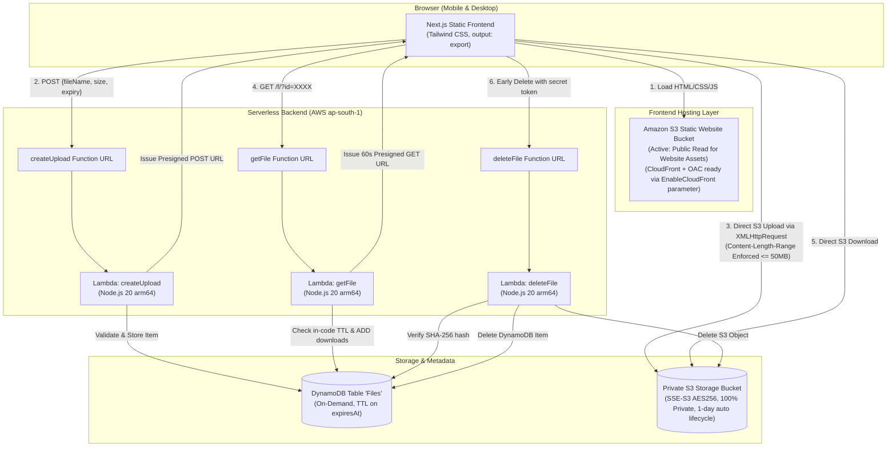

# DropWindow (Serverless Ephemeral File Sharing)

> A blazing-fast, temporary file sharing web application inspired by WeTransfer. Zero always-on servers, zero persistent storage bloat, and end-to-end serverless automation on AWS.

[](https://aws.amazon.com/)
[-green)](https://nodejs.org/)
[-black)](https://nextjs.org/)
[](LICENSE)

---

## Live Deployment & Hosting Status

- **Live Website URL**: [http://dropwindow-serverless-frontendbucket-vpldoqunadd3.s3-website.ap-south-1.amazonaws.com](http://dropwindow-serverless-frontendbucket-vpldoqunadd3.s3-website.ap-south-1.amazonaws.com)
- **Hosting**: The frontend is served from Amazon S3 static website hosting. The template includes a CloudFront + OAC distribution (HTTPS, CDN caching), but AWS had not yet verified this newly created account for CloudFront at submission time, so it is deployed behind an `EnableCloudFront` parameter and disabled (`EnableCloudFront=false`). Enabling CloudFront needs no code changes—simply set the parameter to `true` once AWS Support finishes account verification.

---

## Architecture Overview



---

## Features

1. **Direct-to-S3 Upload**: Files are sent directly from the browser to S3 via presigned POST requests with live upload progress tracking (`XMLHttpRequest`). Lambdas never touch raw file bytes.
2. **Deterministic Expiration**: Flexible retention choices (`1 hour`, `6 hours`, `24 hours`) enforced via DynamoDB TTL and S3 lifecycle rules.
3. **Shareable Links (`/f/?id=XXXX`)**: Ephemeral download page with live countdown timer, file metadata, download counter, and secure presigned download link.
4. **Early Deletion**: Uploader receives a cryptographic `deleteToken` allowing immediate, on-demand purging before expiration.
5. **Atomic Download Counter**: DynamoDB `ADD downloads :inc` provides concurrency-safe counter updates.
6. **Hardened Security**: Dangerous executable and script file extensions (`.exe`, `.bat`, `.cmd`, `.scr`, `.js`, `.vbs`, `.ps1`) are strictly rejected.
7. **Dual-Mode Clipboard Copy**: Seamlessly supports both HTTPS (`navigator.clipboard`) and HTTP (`document.execCommand('copy')` + selectable text boxes).

---

## Design Decisions

### 1. TTL Lag Handling (In-Code Expiration Check)
AWS DynamoDB Time-to-Live (TTL) is designed as a background garbage-collection process. Items marked with an `expiresAt` epoch timestamp may persist up to **48 hours** past their expiration before DynamoDB purges them.
- **Solution**: The `getFile` Lambda actively compares `expiresAt` with the current server time (`Math.floor(Date.now() / 1000)`). If `expiresAt <= now`, the API immediately returns `HTTP 410 Gone`, completely shielding clients from DynamoDB's lazy deletion delay.

### 2. Presigned POST Size Enforcement at S3 Layer
Preventing oversized uploads without routing file data through Lambda requires enforcing limits at the object store boundary:
- **Solution**: `createPresignedPost` includes the condition `['content-length-range', 1, 52428800]`. S3 validates the exact payload length during upload and rejects any upload exceeding 50 MB before writing the object.

### 3. Unguessable File IDs and Cryptographic Delete Tokens
- **File IDs**: Generated via `crypto.randomBytes(12).toString('base64url')` producing 16 unguessable, URL-safe characters with $\approx 96$ bits of entropy. Sequential or incremental identifiers are never used.
- **Delete Tokens**: Generated with 192 bits of entropy (`crypto.randomBytes(24)`). Stored in DynamoDB exclusively as a **SHA-256 hash**. Early deletion requests compare the incoming token's hash using `crypto.timingSafeEqual` to eliminate timing attacks.

### 4. S3 Bucket Security Isolation
The infrastructure strictly isolates the public frontend hosting from private user data:
- **Frontend Bucket**: Only public read for static website hosting (`s3:GetObject`).
- **File Storage Bucket**: **100% Private**. All 4 "Block all public access" settings are permanently enabled (`BlockPublicAcls: true`, `IgnorePublicAcls: true`, `BlockPublicPolicy: true`, `RestrictPublicBuckets: true`). Objects are encrypted with `AES256` and accessed solely via IAM-generated, short-lived presigned URLs.
- **CloudFront OAC Ready**: The CloudFormation template includes a full CloudFront distribution with Origin Access Control (OAC), enabled via the `EnableCloudFront` parameter (`true`/`false`) without requiring any code changes.

### 5. Cross-Environment Clipboard Compatibility
Modern browsers restrict `navigator.clipboard` to Secure Contexts (HTTPS/localhost). For HTTP hosting environments:
- **Solution**: The UI implements an automatic fallback using a hidden textarea and `document.execCommand('copy')`, and displays the share URL and delete token in read-only selectable text boxes with one-click tap-to-select.

---

## Security Notes

- **Zero Server Footprint**: No EC2 instances, containers, or long-running virtual machines to patch or maintain.
- **Least-Privilege IAM Roles**: Each Lambda function is granted only the precise DynamoDB actions (`PutItem`, `GetItem`, `UpdateItem`, `DeleteItem`) and S3 actions (`PutObject`, `GetObject`, `DeleteObject`) necessary for its function.
- **CORS Hardening**: Storage bucket and Function URLs implement explicit CORS headers, allowing only designated HTTP methods and headers. Duplicate CORS headers are eliminated.
- **Filename Sanitization**: Uploaded filenames are sanitized by stripping path traversal characters (`..`, `/`, `\`), control characters, and null bytes.

---

## Performance & Caching Strategy

| Route / Asset Pattern | Cache Layer | Policy / Behavior |
| :--- | :--- | :--- |
| `/_next/static/*` | S3 / CloudFront | **1 Year Immutable Cache** (`public, max-age=31536000, immutable`) |
| `*.html` & `/f/*` | S3 / CloudFront | **No-Cache** (`public, max-age=0, must-revalidate`) for instant updates |
| Direct S3 Download | AWS S3 Edge | **60-second Presigned URL** with attachment `Content-Disposition` |

---

## Setup & Deployment Guide

### Prerequisites
1. **Windows 11 with PowerShell**
2. **Node.js 20+** (`node -v`)
3. **AWS CLI v2** configured with appropriate permissions (`aws configure`)
4. **AWS SAM CLI** (`sam --version`)

### Quick Deploy (One Command)
Run the automated deployment script in PowerShell:

```powershell
# Deploy with S3 Static Website Hosting (Default, immediate deploy)
.\deploy.ps1 -StackName "dropwindow-serverless" -Region "ap-south-1"

# Or deploy with CloudFront + OAC enabled (once account is verified)
.\deploy.ps1 -StackName "dropwindow-serverless" -Region "ap-south-1" -EnableCloudFront "true"
```

The script will automatically:
1. Validate your AWS credentials.
2. Build the serverless backend (`sam build`).
3. Deploy the CloudFormation stack (`sam deploy`).
4. Read the generated Function URLs and S3 bucket names.
5. Compile and export the Next.js frontend (`output: 'export'`) with production API endpoints.
6. Sync the static bundle to the S3 frontend bucket with optimized caching headers (`max-age=31536000` for immutable static assets).
7. Invalidate CloudFront cache (if enabled) and output the live URL.

### Local Unit Testing
Execute the backend unit test suite:

```powershell
npm --prefix backend test
```

---

## Next Steps & Roadmap

1. **CloudFront CDN Activation**: Flip `EnableCloudFront="true"` as soon as AWS Support approves account verification.
2. **Amazon Cognito Authentication**: Optional user accounts for managing upload history and personal quotas.
3. **Automated Malware/Virus Scanning**: EventBridge + AWS Lambda integration with ClamAV or AWS GuardDuty Malware Protection on S3 `PutObject`.
4. **Password-Protected Shares**: Optional client-side encryption or PBKDF2-hashed passcodes for sensitive links.
5. **Multi-File ZIP Archiving**: In-memory ephemeral zip streaming for multi-file drops.

---

## License
MIT License. Free to use, adapt, and distribute.
