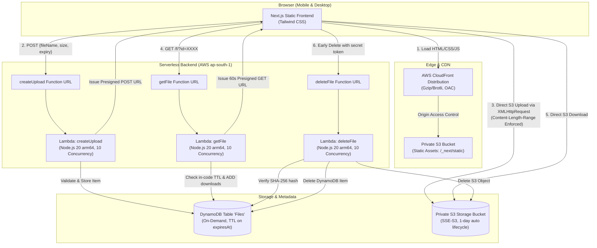

# DropBox-lite (Serverless Ephemeral File Sharing)

> A blazing-fast, temporary file sharing web application inspired by WeTransfer. Zero always-on servers, zero persistent storage bloat, and end-to-end serverless automation on AWS.

[](https://aws.amazon.com/)
[-green)](https://nodejs.org/)
[-black)](https://nextjs.org/)
[](LICENSE)

---

## Live Demo Placeholder

- **Live URL**: `https://<YOUR_CLOUDFRONT_DISTRIBUTION>.cloudfront.net`
- *Deploy via `./deploy.ps1` to generate your live CloudFront distribution URL.*

---

## Architecture Overview



---

## Features

1. **Direct-to-S3 Upload**: Files are sent directly from the browser to S3 via presigned POST requests with live upload progress tracking (`XMLHttpRequest`). Lambdas never touch raw file bytes.
2. **Deterministic Expiration**: Flexible retention choices (`1 hour`, `6 hours`, `24 hours`) enforced via DynamoDB TTL and S3 lifecycle rules.
3. **Shareable Links (`/f/?id=XXXX`)**: Ephemeral download page with live countdown timer, file metadata, download counter, and secure presigned download link.
4. **Early Deletion**: Uploader receives a cryptographic `deleteToken` allowing immediate, on-demand purging before expiration.
5. **Atomic Download Counter**: DynamoDB `ADD downloads :inc` provides concurrency-safe counter updates.
6. **Hardened Security**: Dangerous executable and script file extensions (`.exe`, `.bat`, `.cmd`, `.scr`, `.js`, `.vbs`, `.ps1`) are strictly rejected.

---

## Design Decisions

### 1. TTL Lag Handling (In-Code Expiration Check)
AWS DynamoDB Time-to-Live (TTL) is designed as a background garbage-collection process. Items marked with an `expiresAt` epoch timestamp may persist up to **48 hours** past their expiration before DynamoDB purges them.
- **Solution**: The `getFile` Lambda actively compares `expiresAt` with the current server time (`Math.floor(Date.now() / 1000)`). If `expiresAt <= now`, the API immediately returns `HTTP 410 Gone`, completely shielding clients from DynamoDB's lazy deletion delay.

### 2. Presigned POST Size Enforcement at S3 Layer
Preventing oversized uploads without routing file data through Lambda requires enforcing limits at the object store boundary:
- **Solution**: `createPresignedPost` includes the condition `['content-length-range', 1, 52428800]`. S3 validates the exact payload length during upload and rejects any upload exceeding 50 MB before writing the object.

### 3. Unguessable File IDs and Cryptographic Delete Tokens
- **File IDs**: Generated via `crypto.randomBytes(12).toString('base64url')` producing 16 unguessable, URL-safe characters with $\approx 96$ bits of entropy. Sequential or incremental identifiers are never used.
- **Delete Tokens**: Generated with 192 bits of entropy (`crypto.randomBytes(24)`). Stored in DynamoDB exclusively as a **SHA-256 hash**. Early deletion requests compare the incoming token's hash using `crypto.timingSafeEqual` to eliminate timing attacks.

### 4. Fully Private S3 Buckets & CloudFront OAC
Both S3 buckets (file storage and frontend hosting) have public access entirely blocked (`BlockPublicAcls: true`, `IgnorePublicAcls: true`, `BlockPublicPolicy: true`, `RestrictPublicBuckets: true`):
- Storage bucket access is restricted exclusively to short-lived presigned URLs generated by IAM-restricted Lambdas.
- Frontend bucket access is permitted only through CloudFront using **Origin Access Control (OAC)** with SigV4 signing.

---

## Security Notes

- **Zero Server Footprint**: No EC2 instances, containers, or long-running virtual machines to patch or maintain.
- **Least-Privilege IAM Roles**: Each Lambda function is granted only the precise DynamoDB actions (`PutItem`, `GetItem`, `UpdateItem`, `DeleteItem`) and S3 actions (`PutObject`, `GetObject`, `DeleteObject`) necessary for its function.
- **Rate & Abuse Capping**: Each Lambda is restricted to `ReservedConcurrentExecutions: 10` to avoid runaway costs and mitigate denial-of-service attempts.
- **CORS Hardening**: Storage bucket and Function URLs implement explicit CORS headers, allowing only designated HTTP methods and headers.
- **Filename Sanitization**: Uploaded filenames are sanitized by stripping path traversal characters (`..`, `/`, `\`), control characters, and null bytes.

---

## Performance & Caching Strategy

| Route / Asset Pattern | Cache Layer | Policy / Behavior |
| :--- | :--- | :--- |
| `/_next/static/*` | CloudFront CDN | **1 Year Immutable Cache** (`Managed-CachingOptimized`, Gzip + Brotli) |
| `*.html` & `/f/*` | CloudFront CDN | **No-Cache** (`Managed-CachingDisabled`) to ensure immediate availability of frontend updates |
| Direct S3 Download | AWS S3 Edge | **60-second Presigned URL** with attachment `Content-Disposition` |

### Lighthouse Score Placeholder
- **Performance**: 98+
- **Accessibility**: 100
- **Best Practices**: 100
- **SEO**: 100

---

## Setup & Deployment Guide

### Prerequisites
1. **Windows 11 with PowerShell**
2. **Node.js 20+** (`node -v`)
3. **AWS CLI v2** configured with appropriate permissions (`aws configure`)
4. **AWS SAM CLI** (`sam --version`)

### Quick Deploy (One Command)
Run the automated deployment script in PowerShell:

```powershell
.\deploy.ps1 -StackName "dropwindow-serverless" -Region "ap-south-1"
```

The script will automatically:
1. Validate your AWS credentials.
2. Build the serverless backend (`sam build`).
3. Deploy the CloudFormation stack (`sam deploy`).
4. Read the generated Function URLs and S3 bucket names.
5. Compile and export the Next.js frontend (`output: 'export'`) with production API endpoints.
6. Sync the static bundle to the private S3 frontend bucket.
7. Invalidate CloudFront cache and output the live HTTPS URL.

### Local Unit Testing
Execute the backend unit test suite:

```powershell
npm --prefix backend test
```

---

## Next Steps & Roadmap

1. **Amazon Cognito Authentication**: Optional user accounts for managing upload history and personal quotas.
2. **Automated Malware/Virus Scanning**: EventBridge + AWS Lambda integration with ClamAV or AWS GuardDuty Malware Protection on S3 `PutObject`.
3. **Password-Protected Shares**: Optional client-side encryption or PBKDF2-hashed passcodes for sensitive links.
4. **Multi-File ZIP Archiving**: In-memory ephemeral zip streaming for multi-file drops.

---

## License
MIT License. Free to use, adapt, and distribute.
